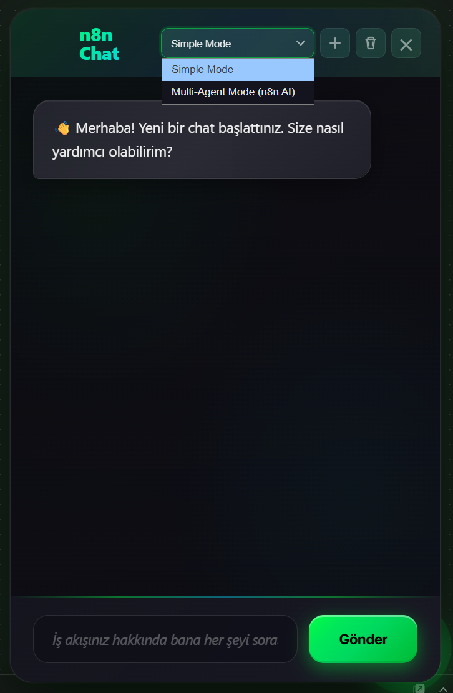

<p align="center">
  
</p>

<p align="center">
  
  
  
  
  
</p>


An intelligent Chrome extension that brings **Cursor-style agentic workflow editing** to n8n. Create, modify, analyze, and debug workflows using natural language with multi-step autonomous execution.



---

## Features

### Agentic Multi-Step Execution
- **Autonomous workflow creation**: AI automatically executes ALL required steps until completion
- **Multi-step planning**: AI breaks down complex requests into actionable steps
- **Continuous execution**: Never stops mid-task - completes the entire workflow automatically
- **Smart continuation**: Context-aware guidance after each function execution

### Multi-Agent Workflow Builder
- **5-agent orchestration system** with deterministic routing
- **Supervisor Agent**: Routes user requests to appropriate specialist agents
- **Discovery Agent**: Searches n8n node catalog and identifies relevant nodes
- **Builder Agent**: Creates workflow nodes and connections, validates graph structure
- **Configurator Agent**: Sets node parameters, validates credentials, provides setup instructions
- **Responder Agent**: Synthesizes internal agent decisions into user-facing responses
- **Per-stage LLM adapters**: Support different AI models for different phases
- **Persistent state**: Chrome storage for workflow session recovery
- **Streaming events**: Real-time phase progress updates (phase_start, phase_complete, phase_error, complete)

### Modern Chat Interface
- **Glassmorphism design** with animated gradients and smooth transitions
- **Real-time streaming** responses with typing effect
- **Function execution badges** with status icons and animations
- **Smart timestamps** with automatic message grouping
- **Drag-and-drop positioning** with persistent layout (Save UI Position)
- **Enhanced markdown** support (code blocks, links, formatting)
- **Message fade delay**: Configurable auto-fade timing for messages
- **Custom system instructions**: Add your own system prompt to guide AI behavior

### Intelligent Workflow Management
- **Create workflows** from natural language descriptions
- **Modify existing nodes** with context-aware updates
- **Analyze workflows** for architecture, performance, and security issues
- **Debug workflows** with integrated real-time logging
- **Auto-fix issues** detected during analysis
- **Smart node selection**: Prefers dedicated service nodes over generic HTTP requests

### LangChain & AI Agent Support
- **Create LangChain agents** with tools, memory, and configuration
- **Add tools to agents** (HTTP Request, Workflow, Code nodes)
- **Configure agent memory** (Window Buffer, Conversation Summary, Vector Store)
- **Multi-agent workflows** (Single Agent, Gatekeeper, Multi-Agent Teams)
- **Chained AI workflows** with multiple AI models in sequence

### Vector Store & RAG Support
- **Vector store connections** (Qdrant, Pinecone, Weaviate, Chroma)
- **Embedding nodes** for text-to-vector conversion
- **Vector search nodes** for semantic search
- **Complete RAG workflows** (Data Source -> Embeddings -> Vector Store -> LLM)

### Workflow Execution Control
- **Execute workflows** with input data and wait for completion
- **Stop running executions**
- **Get execution status** in real-time
- **Retry failed executions** from specific nodes

### Credential Management
- **Check node credentials** configuration
- **Suggest credential types** based on node type
- **Validate credential connections**
- **Get credential details** with usage examples (`={{$credentials.apiKey}}`)
- **Automatic credential assignment** when creating nodes
- **411 credential types** with full documentation

### Sub-workflow Management
- **Create Execute Workflow nodes** for sub-workflows
- **Import workflows as sub-workflows**
- **Get sub-workflow information**

### Advanced Node Configuration
- **Configure webhook settings** (path, method, authentication)
- **Configure schedule/cron** triggers
- **Configure error handling** (retry, continue on fail)

### Batch Processing & Looping
- **Create batch processors** with Split in Batches
- **Create loop nodes** (for each, while, until)
- **Configure split in batches** settings

### Advanced UI Features
- **Workflow visualization** (Mermaid diagrams)
- **Group nodes** visually
- **Set custom node colors** for organization

### Advanced Connection Handling
- **Automatic connection** of newly created nodes
- **Ghost connection cleanup** prevents workflow corruption
- **Vue reactivity sync** eliminates race conditions
- **Connection verification** ensures workflow integrity

### Multi-Provider AI Support
- **OpenAI** (GPT-5.2, GPT-4o, GPT-4o Mini, o3, o4-mini, GPT-4 Turbo, GPT-3.5 Turbo)
- **Anthropic** (Claude 4.5 Sonnet/Opus/Haiku, Claude 4.1 Opus, Claude 4 Opus/Sonnet, Claude 3.5 Legacy)
- **Google Gemini** (Gemini 2.5 Pro/Flash/Flash Lite, Gemini 1.5 Pro/Flash)
- **DeepSeek** (DeepSeek Chat V3.2, DeepSeek Reasoner V3.2)
- **OpenRouter** (GLM-4.7, Gemini 3 Flash/Pro, DeepSeek V3.2, Llama 4 Maverick/Scout, Devstral, and 100+ more)
- **Groq** (Llama 3.3/3.1, Llama 3 Groq Tool-Use, Mistral Small 3, Mixtral)
- **Hugging Face** (FunctionGemma, Qwen 3, Llama, NovaSky, and more function-calling models)

> **Note:** Cohere and Local LLM were supported in earlier versions but are now deprecated. Existing configurations are automatically migrated to Google Gemini.

### Model Auto-Optimization
- **Automatic temperature/topP/maxTokens** settings per model
- Model-specific optimal configurations for 90+ models
- **Custom model input**: Enter any model name manually via toggle button
- **Thinking mode** support for reasoning models (o3, o4-mini, DeepSeek Reasoner)
- **Google Search** toggle for Gemini models with grounding

### Real-Time Debugging
- **Integrated debug server** with WebSocket support
- **Function call logging** with full argument tracking
- **Error tracking** with stack traces and context
- **Session summaries** with operation metrics
- **Toggle on/off** directly from extension popup
- **Debug Server URL**: Configurable server endpoint (default: `http://localhost:3333`)
- **Auto-connect on startup**: Automatically connect to debug server
- **Console logging**: Toggle browser console output
- **PII masking**: Automatically mask sensitive data in logs
- **Quick actions**: Open dashboard, clear logs, test connection

### Language Consistency
- **Automatic language detection**: Responds in the same language as user's input
- Supports Turkish, English, Spanish, and more
- Never switches languages mid-conversation
- Full i18n support with English and Turkish locales

---

## Installation

### Prerequisites
- Google Chrome or Chromium-based browser (Edge, Brave, etc.)
- n8n instance (cloud or self-hosted)
- API key from one of the supported AI providers

### Install from Chrome Web Store
1. Visit the [Chrome Web Store](https://chrome.google.com/webstore) *(coming soon)*
2. Click "Add to Chrome"
3. Pin the extension to your toolbar

### Install from Source
1. **Clone the repository:**
   ```bash
   git clone https://github.com/ForgeLLC/n8n-workflow-agent.git
   cd n8n-workflow-agent
   ```

2. **Load the extension in Chrome:**
   - Open Chrome and navigate to `chrome://extensions/`
   - Enable "Developer mode" (top right)
   - Click "Load unpacked"
   - Select the project root folder (`n8n-workflow-agent`)

3. **Configure your API keys:**
   - Click the extension icon in your toolbar
   - Go to Settings -> API tab
   - Select your preferred AI provider
   - Enter your API key
   - Click "Save"

---

## Usage

### Getting Started

1. **Navigate to n8n:**
   - Open your n8n workflow editor (e.g., `https://app.n8n.cloud/workflow/...`)

2. **Activate the extension:**
   - Click the extension icon
   - Click "Activate on Current Page"
   - A floating chat button will appear in the bottom right

3. **Start chatting:**
   - Click the floating chat button
   - Type your request in natural language
   - Press Enter or click "Send"

### Example Prompts

#### **Create Workflows**
```
Create a workflow that:
- Gets data from Supabase
- Summarizes content with AI
- Sends result to Telegram
```

#### **Modify Workflows**
```
Replace all Google Sheets nodes with Supabase nodes
```

#### **Analyze Workflows**
```
Analyze this workflow for performance and security issues
```

#### **Debug Workflows**
```
Why isn't my webhook trigger working?
```

#### **Get Information**
```
Show me the workflow structure and connections
```

#### **Create AI Agent Workflows**
```
Create an AI agent that can search the web and send results to Telegram
```

#### **Create RAG Workflows**
```
Create a RAG workflow that answers questions from company PDFs using Qdrant
```

#### **Configure Workflows**
```
Configure the webhook node to accept POST requests at /webhook/my-endpoint
```

---

## Key Concepts

### Agentic Execution Model

The extension operates in **agentic mode**, meaning it **autonomously executes multiple steps** to complete complex tasks:

1. **User Request**: "Replace Google Sheets with Supabase"
2. **AI Planning**: Breaks down into steps:
   - Get workflow info
   - Remove Google Sheets nodes
   - Create Supabase nodes
   - Connect new nodes
   - Clean layout
   - Validate workflow
3. **Autonomous Execution**: AI executes ALL steps sequentially without stopping
4. **Verification**: AI confirms completion and reports results

**No manual intervention required** - the AI handles the entire workflow lifecycle.

### Multi-Agent Workflow Builder

The extension includes a sophisticated **5-agent orchestration system** based on n8n's AI Workflow Builder architecture:

```
User Message
    |
[SUPERVISOR] --> Routes to appropriate specialist
    |
    +-> [DISCOVERY]     Search node catalog, identify nodes
    |       |
    +-> [BUILDER]       Create nodes, connect them, validate structure
    |       |
    +-> [CONFIGURATOR]  Set parameters, validate credentials
    |       |
    +-> [RESPONDER]     Synthesize results into user response
```

Each agent has specialized prompts, tools, and can use different LLM models for optimal cost/performance.

### Smart Node Selection

The AI **automatically prefers dedicated service nodes** over generic HTTP requests:

| User Intent | Selected Node Type |
|-------------|-------------------|
| "Use OpenAI" | `@n8n/n8n-nodes-langchain.openAi` |
| "Connect to Supabase" | `n8n-nodes-base.supabase` |
| "Send to Telegram" | `n8n-nodes-base.telegram` |
| "Google Sheets" | `n8n-nodes-base.googleSheets` |
| "PostgreSQL database" | `n8n-nodes-base.postgres` |

**HTTP Request node** is used ONLY when no dedicated node exists.

Semantic search supports 1000+ nodes (788 official + 212 community) in any language.

### Connection Management

Every created node is **automatically connected** to the workflow:

```
Trigger -> Processing -> AI/Logic -> Storage/Output
```

**Rules enforced:**
- No floating/orphan nodes
- Logical flow maintained
- All connections verified
- Ghost connections cleaned up

---

## Configuration

### AI Provider Settings

Navigate to **Settings -> API** in the extension popup:

| Provider | Required | Get API Key |
|----------|----------|-------------|
| **Google Gemini** | API Key | [aistudio.google.com](https://aistudio.google.com/app/apikey) |
| **OpenAI** | API Key | [platform.openai.com](https://platform.openai.com/api-keys) |
| **Anthropic** | API Key | [console.anthropic.com](https://console.anthropic.com/settings/keys) |
| **DeepSeek** | API Key | [platform.deepseek.com](https://platform.deepseek.com/) |
| **OpenRouter** | API Key | [openrouter.ai](https://openrouter.ai/keys) |
| **Groq** | API Key | [console.groq.com](https://console.groq.com/keys) |
| **Hugging Face** | API Key | [huggingface.co](https://huggingface.co/settings/tokens) |

### Chat Settings

Navigate to **Settings -> Chat**:

#### General Settings
- **Custom System Instructions**: Add your own system prompt to customize AI behavior
- **Include Workflow Context**: Send current workflow data with each request
- **Save UI Position**: Remember chat window position between sessions
- **Message Fade Delay**: Set auto-fade delay for messages (0-60 seconds, 0 = disabled)

#### Tools (Toggle On/Off)
- **Workflow Access**: Allow AI to read workflow information
- **Node Library Access**: Allow AI to browse available node types
- **Node Creation**: Allow AI to create new nodes
- **Node Editing**: Allow AI to modify node parameters
- **Node Removal**: Allow AI to delete nodes
- **Affiliate Recommendations**: Enable affiliate-based service recommendations
- **Node Cloning**: Allow AI to duplicate nodes with settings
- **Advanced Connection Management**: Allow AI to remove/update node connections
- **Bulk Operations**: Allow AI to update/disable multiple nodes at once
- **Auto Layout**: Allow AI to auto-arrange nodes on canvas
- **Workflow Validation**: Allow AI to validate workflow structure
- **Workflow Execution**: Allow AI to test-execute workflows
- **Advanced Import/Export**: Allow AI to import/export/merge workflows
- **Execution History & Analytics**: Allow AI to view execution history and performance
- **Workflow Templates**: Allow AI to use and create workflow templates
- **Workflow Optimization**: Allow AI to analyze and suggest optimizations
- **Workflow Versioning**: Allow AI to create/restore workflow snapshots
- **Advanced Debugging**: Allow AI to debug workflows with trace/profile modes
- **Testing Framework**: Allow AI to generate and run test suites
- **CI/CD Integration**: Allow AI to generate CI/CD configurations
- **Custom Node Development**: Allow AI to generate custom node templates
- **Documentation Generation**: Allow AI to generate workflow documentation

### Advanced Settings

- **Temperature** (0.0 - 1.0): Controls response creativity (auto-managed per model)
- **Max Tokens**: Maximum tokens for AI response (auto-managed per model)
- **Top P** (0.0 - 1.0): Controls response diversity (auto-managed per model)
- **Thinking Mode**: Extended thinking for reasoning models (o3, o4-mini, DeepSeek Reasoner)
- **Google Search**: Enable Google Search grounding for Gemini models

---

## Available Functions (60+)

### Phase 1: Core Operations
| Function | Description |
|----------|-------------|
| `create_node` | Create a new node in the workflow |
| `update_node` | Update an existing node's parameters |
| `remove_node` | Remove a node from the workflow |
| `add_connection` | Add a connection between two nodes |
| `remove_connection` | Remove a connection between nodes |
| `clone_node` | Clone a node with all settings |
| `search_nodes` | Search available node types |
| `get_workflow_info` | Get workflow structure info |
| `get_node_info` | Get detailed node information |
| `get_node_schema` | Get parameter schema for a node type |
| `find_node_by_intent` | Find nodes from natural language intent |
| `get_node_credentials` | Get required credential types for a node |
| `get_credential_details` | Get credential fields and usage examples |
| `get_credential_usage_examples` | Get `={{$credentials.xxx}}` examples |
| `bulk_update_nodes` | Update multiple nodes at once |
| `bulk_disable_nodes` | Disable/enable multiple nodes |
| `auto_arrange_nodes` | Auto-arrange nodes in clean layout |
| `validate_workflow` | Validate workflow and find issues |
| `test_workflow` | Test workflow execution |
| `get_workflow_variables` | Get workflow variables (PII-safe) |
| `export_workflow` | Export workflow as JSON |

### Phase 2: Advanced Features
| Function | Description |
|----------|-------------|
| `import_workflow` | Import a workflow from JSON |
| `merge_workflows` | Merge two workflows together |
| `get_execution_history` | Get execution history and results |
| `analyze_performance` | Analyze performance and bottlenecks |
| `get_workflow_templates` | Get available workflow templates |
| `create_from_template` | Create workflow from template |
| `get_node_execution_data` | Get execution data for a node |
| `compare_workflows` | Compare two workflows |
| `optimize_workflow` | Analyze and suggest optimizations |

### Phase 3: Enterprise Features
| Function | Description |
|----------|-------------|
| `create_workflow_snapshot` | Create a version snapshot |
| `list_workflow_snapshots` | List saved snapshots |
| `restore_workflow_snapshot` | Restore to a previous snapshot |
| `debug_workflow` | Advanced debugging (analyze/trace/profile) |
| `generate_test_cases` | Generate test cases for validation |
| `run_test_suite` | Execute test suite and report results |
| `generate_cicd_config` | Generate CI/CD configuration (GitHub Actions, GitLab CI, Jenkins) |
| `generate_custom_node` | Generate custom node template |
| `generate_workflow_docs` | Generate workflow documentation (Markdown/HTML/JSON) |

### Phase 4: AI & Integrations
| Function | Description |
|----------|-------------|
| `create_langchain_agent` | Create a LangChain AI agent |
| `add_tool_to_agent` | Add tool to an agent |
| `configure_agent_memory` | Configure agent memory |
| `connect_agent_to_tool` | Connect agent to tool node |
| `create_vector_store_connection` | Connect to vector store (Qdrant, Pinecone, Weaviate, Chroma) |
| `create_embedding_node` | Create embedding node |
| `create_vector_search_node` | Create vector search node |
| `create_rag_workflow` | Create complete RAG workflow |
| `execute_workflow` | Execute workflow with input data |
| `stop_workflow_execution` | Stop running execution |
| `get_execution_status` | Get execution status |
| `retry_failed_execution` | Retry failed execution |
| `check_node_credentials` | Check node credentials |
| `suggest_credential_type` | Suggest credential type for node |
| `validate_credential_connection` | Validate credential connection |
| `create_subworkflow_node` | Create Execute Workflow node |
| `import_subworkflow` | Import as sub-workflow |
| `get_subworkflow_info` | Get sub-workflow info |
| `configure_node_webhook` | Configure webhook settings |
| `configure_node_schedule` | Configure schedule/cron settings |
| `configure_node_error_handling` | Configure error handling |
| `create_batch_processor` | Create batch processing setup |
| `create_loop_node` | Create loop node (for each/while/until) |
| `configure_split_in_batches` | Configure batch settings |
| `create_workflow_visualization` | Generate Mermaid diagram |
| `group_nodes` | Group nodes visually |
| `set_node_color` | Set custom node color |
| `create_chained_ai_workflow` | Create chained AI workflow |
| `create_single_agent_workflow` | Create single agent workflow |
| `create_gatekeeper_workflow` | Create gatekeeper multi-agent workflow |
| `create_multi_agent_team` | Create multi-agent team workflow |

---

## Debugging

### Enable Debug Mode

1. Open extension popup
2. Navigate to "Chat" tab -> Debug Mode section
3. Toggle "Enable Real-Time Debug API"
4. Configure debug options:
   - **Server URL**: Debug server endpoint (default: `http://localhost:3333`)
   - **Auto-connect**: Automatically connect when extension starts
   - **Console Logging**: Enable/disable browser console output
   - **PII Masking**: Mask sensitive data in debug logs
5. Use Quick Actions: Open Dashboard, Clear Logs, Test Connection

### Debug Server (Optional)

For advanced debugging with WebSocket support:

```bash
cd debug-server
npm install
node server.js
```

The debug server provides:
- Real-time function call logging
- Error tracking with stack traces
- Session summaries
- WebSocket streaming

---

## Architecture

```
+---------------------------------------------------+
|              Chrome Extension (MV3)                |
+---------------------------------------------------+
|  content.js   | Chat UI, Stream Handler, Security  |
|  injected.js  | n8n Canvas Manipulation (Vue/Pinia) |
|  popup.js     | Settings, Provider Config, Debug    |
|  background/  | API Handlers, Workflow Builder      |
+---------------------------------------------------+
                    | (Function Calls)
+---------------------------------------------------+
|              n8n Workflow Editor                    |
+---------------------------------------------------+
|  Vue.js App  |  Pinia Store  |  Canvas Operations  |
+---------------------------------------------------+
```

### Key Components

- **`content/content.js`**: Chat UI, message streaming, conversation history, SecurityUtils (rate limiting, input validation, XSS sanitization)
- **`content/injected.js`**: Direct n8n canvas manipulation, node CRUD, connection management via Vue/Pinia store
- **`content/functions/index.js`**: 60+ function definitions for AI tool calling (4 phases)
- **`content/functions/executor.js`**: Function execution engine
- **`popup/popup.js`**: Extension settings, API configuration, model auto-optimization, debug controls
- **`background/background.js`**: Service worker with port-based message routing and security whitelist
- **`background/api-handlers.js`**: Multi-provider AI streaming handlers (OpenAI-compatible shared handler, Anthropic, Gemini, HuggingFace, LocalLLM)
- **`background/workflow-builder-handler.js`**: Multi-agent workflow builder orchestration
- **`ai/adapters/`**: Provider-specific AI adapters (Anthropic, OpenAI, Gemini, OpenRouter, HuggingFace, BaseAdapter)
- **`ai/client.js`**: AI client with `analyzeWorkflow()` and `generateBlueprint()` functions
- **`ai/schemas/`**: JSON schemas for structured AI responses
- **`lib/workflow-builder/`**: Multi-agent workflow builder system
  - `index.js`: WorkflowBuilder class with async generator chat interface
  - `agents/`: Supervisor, Discovery, Builder, Configurator, Responder agents
  - `prompts/`: Per-agent system prompts
  - `state/`: Persistent workflow builder state (Chrome Storage)
  - `tools/`: Tool adapter mapping agent tools to extension functions
  - `config/llm-config.js`: LLM model configurations (Anthropic, OpenAI, OpenRouter)
  - `utils/`: Node types loader, coordination log, session manager
- **`lib/storage.js`**: Secure Chrome storage for settings and API keys

---

## Supported Nodes & Credentials

### Node Support

**Total: 1000+ Nodes**

#### Official Nodes (788 nodes)
- **IO / Triggers / API & Data**: 300+ nodes (Webhooks, HTTP Request, Schedule Trigger, Telegram Trigger, Database nodes, API integrations)
- **Logic / Conditional**: 50+ nodes (If, Switch, Merge, Wait)
- **Flow Control**: 30+ nodes (Split, Merge, Loop)
- **Data Transform**: 100+ nodes (Set, Edit Fields, Transform)
- **Code / Script**: 20+ nodes (Code, Function)
- **AI / LLM**: 50+ nodes (OpenAI, Anthropic, Gemini, LangChain agents)
- **Communication**: 100+ nodes (Telegram, Slack, Discord, Email, SMS)
- **File / Storage**: 80+ nodes (AWS S3, Google Drive, Dropbox)
- **Commerce / Payment**: 50+ nodes (Stripe, PayPal, Razorpay)

#### Community Nodes (212 nodes)
- Community-developed integrations
- Custom service connectors
- Specialized workflow tools

### Credential Support

**Total: 411 Credential Types**

- **API Credentials**: 200+ types (API keys, OAuth2, Basic Auth)
- **Database Credentials**: 30+ types (PostgreSQL, MySQL, MongoDB, Redis)
- **Cloud Service Credentials**: 100+ types (AWS, Google Cloud, Azure)
- **Communication Credentials**: 50+ types (Telegram, Slack, Discord, Email)
- **Payment Credentials**: 30+ types (Stripe, PayPal, Razorpay)

For each credential:
- Field definitions (apiKey, accessToken, etc.)
- Usage examples (`={{$credentials.apiKey}}` format)
- Authentication configuration
- Test configuration

---

## Security & Privacy

### Data Handling
- **API keys** are stored securely in Chrome's encrypted storage
- **No telemetry** or usage tracking
- **No server-side processing** - all AI requests go directly to your chosen provider
- **Local-first**: Chat history stored locally in your browser
- **PII masking** in debug logs (configurable)

### Security Features
- **Rate limiting**: Built-in request throttling
- **Input validation**: Schema-based validation for all function parameters
- **XSS sanitization**: Automatic sanitization of user inputs
- **Port whitelist**: Only allowed communication ports accepted
- **Origin verification**: Messages verified from extension context only
- **CSP headers**: Strict Content Security Policy for extension pages

### Permissions Explained
- **`storage`**: Save settings and API keys locally
- **`scripting`**: Inject content scripts into n8n pages
- **`tabs`**: Detect n8n workflow pages
- **`activeTab`**: Access current tab for activation
- **`host_permissions`**: Connect to AI provider APIs
- **`optional_host_permissions`**: Local debug server (localhost)

### What is Sent to AI Providers?
- Your workflow structure (nodes, connections, parameters) - **only when "Include Workflow Context" is enabled**
- Your chat messages
- Function call results

**What is NOT sent:**
- Credentials or API keys stored in your workflows
- Sensitive data (masked automatically)
- Your IP address or personal information (beyond what the AI provider collects)

---

## What's New

### v1.6.1 (Latest)

- Removed deprecated o7 API provider
- Bug fixes and stability improvements
- Hugging Face function calling support fix

### v1.6.0 (2026-01-22)

**Comprehensive Node & Credential Intelligence:**
- Semantic node selection from user intent (`find_node_by_intent()`)
- Complete credential database (411 credential types)
- Credential usage examples (`={{$credentials.apiKey}}` format)
- 1000+ node support (788 official + 212 community nodes)
- Automatic credential assignment when creating nodes
- Enhanced node discovery functions
- Credential details with authentication configuration
- Multi-agent workflow builder system
- Hugging Face provider support
- Model auto-optimization for 90+ models
- Custom model input support
- Thinking mode for reasoning models
- Google Search grounding for Gemini

**New Functions:**
- `find_node_by_intent()` - Find nodes from natural language
- `get_node_credentials()` - Get credential requirements for a node
- `get_credential_details()` - Get full credential information
- `get_credential_usage_examples()` - Get credential usage examples

### v1.5.0

**Phase 4 Features:**

**LangChain & AI Agent Support:**
- Create LangChain agent nodes with tools and memory
- Connect tools to agents automatically
- Configure agent memory (Window Buffer, Conversation Summary, Vector Store)
- Support for all n8n AI agentic workflow patterns

**Vector Store & RAG:**
- Vector store connections (Qdrant, Pinecone, Weaviate, Chroma)
- Embedding node creation
- Vector search nodes
- Complete RAG workflow generation

**Workflow Execution:**
- Execute workflows programmatically
- Stop and monitor executions
- Retry failed executions

**Credential Management:**
- Check node credentials
- Suggest credential types
- Validate credential connections

**Advanced Features:**
- Sub-workflow management
- Advanced node configuration (webhooks, schedules, error handling)
- Batch processing and looping
- Workflow visualization (Mermaid diagrams)
- Node grouping and custom colors

---

## Known Issues & Limitations

- **Vue Store Access**: The extension relies on n8n's internal Vue/Pinia store structure. Future n8n updates may break compatibility temporarily.
- **Race Conditions**: Fixed with `waitForVueUpdate()`, but edge cases may exist.
- **Token Limits**: Large workflows may exceed model context windows. Use "Lazy Loading" context strategy or disable "Node Library Access".
- **Language Switching**: AI may occasionally switch languages mid-conversation (rare, fixed in v1.4.2).
- **Vector Store Credentials**: Vector store connections require manual credential configuration in n8n settings (security best practice).

See [Issues](https://github.com/ForgeLLC/n8n-workflow-agent/issues) for full list.

---

## Contributing

Contributions are welcome! Please read [CONTRIBUTING.md](CONTRIBUTING.md) for details on our code of conduct and the process for submitting pull requests.

### Development Setup

1. **Clone the repo:**
   ```bash
   git clone https://github.com/ForgeLLC/n8n-workflow-agent.git
   cd n8n-workflow-agent
   ```

2. **Install debug server dependencies (optional):**
   ```bash
   cd debug-server
   npm install
   ```

3. **Load extension in Chrome:**
   - Enable Developer mode in `chrome://extensions/`
   - Click "Load unpacked" and select the project root folder

4. **Make your changes**

5. **Test thoroughly** on n8n workflows

6. **Submit a pull request**

---

## License

This project is licensed under the MIT License - see the [LICENSE](LICENSE) file for details.

---

## Acknowledgments

- **n8n** for building an amazing workflow automation platform
- **OpenAI, Anthropic, Google, DeepSeek, Groq, Hugging Face** for providing powerful AI models
- **Cursor** for inspiring the agentic execution model
- **The n8n Community** for feedback and feature requests

---

## Support


- **GitHub**: [ForgeLLC](https://github.com/ForgeLLC)
- **Issues**: [GitHub Issues](https://github.com/ForgeLLC/n8n-workflow-agent/issues)

---

## Star History

If you find this project useful, please consider giving it a star!

---

## Screenshots

### Chat Interface


### Settings


---

<div align="center">
  <strong>Made with love for the n8n community</strong>
</div>

<br>

<p align="center">
  <sub><code>process exited with code 0</code> · <i>built by <a href="https://github.com/ForgeLLC">ForgeLLC</a></i></sub>
</p>

<p align="center">
  
</p>
